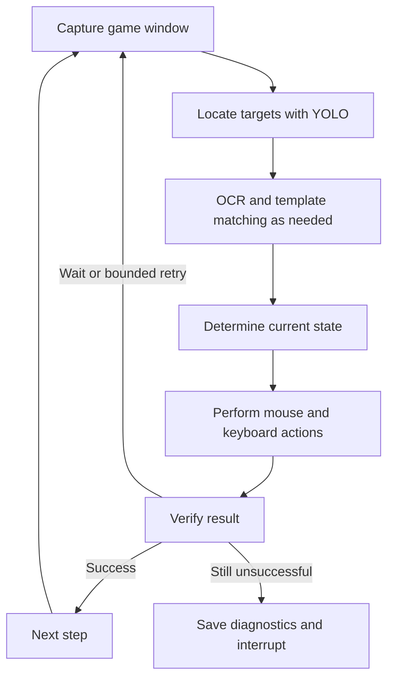

# Miliastra Archive Tool

I am a Miliastra Wonderland enthusiast. Uploading a stage archive to multiple servers means repeatedly switching servers, importing archives, filling in stage information, and handling image resources. I built this tool to make that repetitive process easier and leave more time for creating stages.

Miliastra Archive Tool is a Windows desktop application. Prepare your archives, multilingual descriptions, and media resources in advance, then let the tool work through the upload process by recognizing the game interface.

**This tool cannot be used with the mainland China (CN) version of Genshin Impact. It is intended for the international client.** Support for a Simplified Chinese interface refers to the interface language of the international client, not support for the CN client.

This is an independent fan project, with no affiliation or partnership with the game publisher.

## Download

- [Download the complete Windows x64 application](https://github.com/zybpl/MiliastraArchiveTool/releases/download/v2026.10.26/MiliastraArchiveTool-20261026-win-x64.zip)
- [Release notes and checksums](https://github.com/zybpl/MiliastraArchiveTool/releases/tag/v2026.10.26)

Extract the entire archive and run `MiliastraArchiveTool.exe`. The package includes the .NET runtime, recognition models, and an English/Chinese user guide. You do not need the .NET SDK to use the application. The source ZIP is intended for developers.

## Features

- Manage local archives and their descriptions, tags, images, and video settings.
- Upload or update archives across servers according to your task configuration.
- Fill in preview information and multilingual content, handle image resource drafts, and submit them for review.
- Verify key steps, save diagnostics when something goes wrong, and continue interrupted tasks within supported pages.

**Submitting image resources for review does not publish them.** Any content that requires manual publication after approval must still be published in the game.

## How it works

The tool follows a **capture → recognize → act → verify** loop. It operates the game through Windows mouse and keyboard input and interactions with file selection dialogs.

1. **Capture the game window:** A screenshot provides the current visual state.
2. **Locate interface elements:** A YOLO model detects pages and targets such as buttons, archive cards, and input areas. Inference runs locally with ONNX Runtime.
3. **Combine text and image evidence:** RapidOCR reads text within relevant regions, including button labels, archive identifiers, and upload counters. OpenCV template matching helps locate fixed language labels and small icons. Recognition runs locally without sending screenshots to a cloud OCR service.
4. **Perform the action:** The tool clicks, scrolls, selects files, and fills in information based on the detected state. Multilingual text is pasted through the Unicode clipboard. Confirmed column positions are reused within the same table viewport while language rows are checked to reduce repeated localization.
5. **Verify before proceeding:** The workflow checks page transitions, table stability, and changes in upload counters or status. Selected steps use multiple observations and bounded retries to handle loading delays. On failure, logs and diagnostic screenshots support troubleshooting and task continuation.

The tool depends on the visible game interface. Obstructed windows, UI updates, loading delays, and recognition errors can affect execution. OCR readback of multilingual content helps detect anomalies but does not guarantee an exact character-by-character match. Please review the actual content in the game after uploading.


### Recognition and action flow



## Before you start

- Use Windows x64 and run the game in **windowed mode**. **1920 × 1080** is the recommended starting resolution for testing. Keep the entire game window visible.
- The game interface currently supports **Simplified Chinese and English**. Archive descriptions can be configured in 15 languages; archive content language and game interface language are separate settings.
- Make sure the archive's default language matches the game language, and prepare the `.gil` archive and any required media files.
- Start the task from the **Start Game screen** where possible. Preflight checks confirm the starting screen and language before proceeding.
- Keep the game window visible during execution. Avoid manually using the mouse or keyboard or changing the clipboard.
- **Allow time for the sandbox to start:** startup time varies between machines. Watch the tool's status and the game's loading progress. Do not switch pages simply because the tool has not clicked anything for a while.

If a task is interrupted, read the message and resolve the issue while keeping the game on the corresponding page, then select **Continue**. Continuation supports recovery within a limited scope on the same page; it does not automatically reconstruct a scene that has been changed arbitrarily.

For full instructions, see the [English/Chinese user guide (PDF, English first)](docs/user-guide-bilingual/MiliastraArchiveTool_User_Guide_EN_ZH.pdf). The guide was prepared for an earlier version; refer to the current application and this README for subsequent changes.

## Local data

For a standalone extracted installation, data is normally stored under the application directory:

```text
runtime-data/MiliastraArchiveTool/
├── archives/             # Archives, resources, and each archive's metadata.json
├── logs/diagnostics/     # Diagnostic logs and screenshots
└── upload-runs/          # Upload task run records
```

When running from a source checkout, the application searches parent directories for `MiliastraArchiveTool.sln` or a `.git` directory and uses `runtime-data` under that directory. Back up the entire `runtime-data` folder before upgrading.

When reporting an issue, include the application version, game language, resolution, the step that failed, and the relevant diagnostic logs. Before sharing, review logs and screenshots for information such as your UID, file paths, and archive content.

## Build from source

Windows and the .NET 8 SDK are required. Run these commands from the repository root:

```powershell
dotnet restore MiliastraArchiveTool/MiliastraArchiveTool.csproj
dotnet build MiliastraArchiveTool/MiliastraArchiveTool.csproj -c Release
```

The application requires the YOLO and OCR models and template assets included in the project. Preserve their directory structure. Refer to the [project file](MiliastraArchiveTool/MiliastraArchiveTool.csproj) for dependency versions.

## License and acknowledgments

Original code in this project is licensed under the **GNU Affero General Public License v3.0 (AGPL-3.0-only)**. See [LICENSE](LICENSE) for the full terms.

This project uses open-source components including Ultralytics YOLO, ONNX Runtime, RapidOcrNet / RapidOCR, OpenCvSharp, and Vortice. Thanks to their maintainers. Third-party code, models, and dependencies retain their own licenses and copyright notices; this project's license does not replace those notices. [Ultralytics' licensing information](https://www.ultralytics.com/license) describes its open-source licensing approach for code and trained models.

Rights to game names, screenshots, and interface assets remain with their respective rights holders. Making this project open source does not grant rights to those materials.

---

## 中文说明

本工具不支持国服客户端。简体中文界面支持指国际服客户端的界面语言，不代表支持国服版本。

### 基本原理

工具采用“**截图 → 识别 → 操作 → 检查结果**”的方式工作，通过 Windows 的鼠标、键盘输入和文件选择窗口交互来操作游戏。

1. **获取画面**：捕获游戏窗口，作为当前页面状态的依据。
2. **定位界面元素**：使用 YOLO 模型识别页面和按钮、卡片、输入区域等目标，通过 ONNX Runtime 在本机推理。
3. **结合文字与图像判断**：使用 RapidOCR 读取目标区域内的按钮文字、存档标识、上传计数等；对固定的语言名称和小图标，使用 OpenCV 模板匹配辅助定位。识别任务在本机执行，无需把截图发送到云端 OCR 服务。
4. **执行操作**：依据识别结果点击、滚动、选择文件和填写内容。多语言文本通过 Unicode 剪贴板粘贴；同一表格视区内复用已确认的列坐标，并核对语言行，减少重复定位。
5. **确认结果后继续**：检查页面是否切换、表格是否稳定，以及上传计数或状态是否变化。部分步骤通过多帧确认和有限重试处理加载延迟；失败后保留日志和诊断截图，供排查或继续任务使用。

它依赖游戏界面的实际显示，窗口遮挡、界面改版、加载延迟和识别误差都可能影响运行。多语言正文的 OCR 回读用于辅助发现异常，不能保证逐字校验正确；上传后仍应核对游戏内的实际内容。

### 使用前准备

- 使用 Windows x64，并让游戏以**窗口模式**运行。建议从 **1920 × 1080** 分辨率开始测试，确保窗口完整可见。
- 游戏界面目前适配**简体中文和英文**。存档介绍可配置 15 种语言；这与游戏界面语言是两个不同的设置。
- 检查存档默认语言与游戏语言是否一致，准备好 `.gil` 存档及需要的媒体文件。
- 建议从**开始游戏界面**启动任务，由预检确认起点和语言后再继续。
- 任务运行期间保持游戏窗口可见，避免手动操作鼠标、键盘或更改剪贴板。
- **等待沙箱启动需要耐心**：不同机器的启动速度不同。这一步没有统一的实际耗时，请结合工具状态和游戏加载情况观察，不要因为暂时没有后续点击就立即切换页面。

中断后，请先查看提示并处理当前问题，保持在中断对应的页面，再使用“继续”。继续功能适用于限定范围内的同页面恢复，不会自动还原任意改变过的现场。

完整操作说明见 [中英文用户手册（PDF，英文在前）](docs/user-guide-bilingual/MiliastraArchiveTool_User_Guide_EN_ZH.pdf)。手册基于较早版本整理，后续功能调整以当前程序和本 README 为准。

### 本地数据

独立解压运行时，数据通常保存在程序目录下：

```text
runtime-data/MiliastraArchiveTool/
├── archives/             # 存档、资源及各存档的 metadata.json 配置
├── logs/diagnostics/     # 诊断日志和截图
└── upload-runs/          # 上传任务运行记录
```

从源码目录运行时，程序会向上查找 `MiliastraArchiveTool.sln` 或 `.git` 目录，并使用该目录下的 `runtime-data`。升级前请备份整个 `runtime-data` 文件夹。

反馈问题时，请提供版本、游戏语言、分辨率、出现问题的步骤及对应诊断日志。分享前请检查日志和截图中的 UID、文件路径及存档内容等信息。

### 从源码构建

需要 Windows 和 .NET 8 SDK。在仓库根目录执行：

```powershell
dotnet restore MiliastraArchiveTool/MiliastraArchiveTool.csproj
dotnet build MiliastraArchiveTool/MiliastraArchiveTool.csproj -c Release
```

运行时需要项目中的 YOLO、OCR 模型和模板资源，请保留这些资源的目录结构。依赖版本以 [项目文件](MiliastraArchiveTool/MiliastraArchiveTool.csproj) 为准。

### 开源协议与致谢

本项目原创代码采用 **GNU Affero General Public License v3.0（AGPL-3.0-only）**，完整条款见 [LICENSE](LICENSE)。

项目使用 Ultralytics YOLO、ONNX Runtime、RapidOcrNet / RapidOCR、OpenCvSharp 和 Vortice 等开源组件，感谢这些项目的维护者。第三方代码、模型及其依赖保留各自的许可证和版权声明；本项目的许可证不替代这些声明。[Ultralytics 的许可说明](https://www.ultralytics.com/license)涵盖其代码与训练模型的开源许可方式。

游戏名称、截图及界面素材的相关权利归原权利人所有，不因本项目开源而转授。
